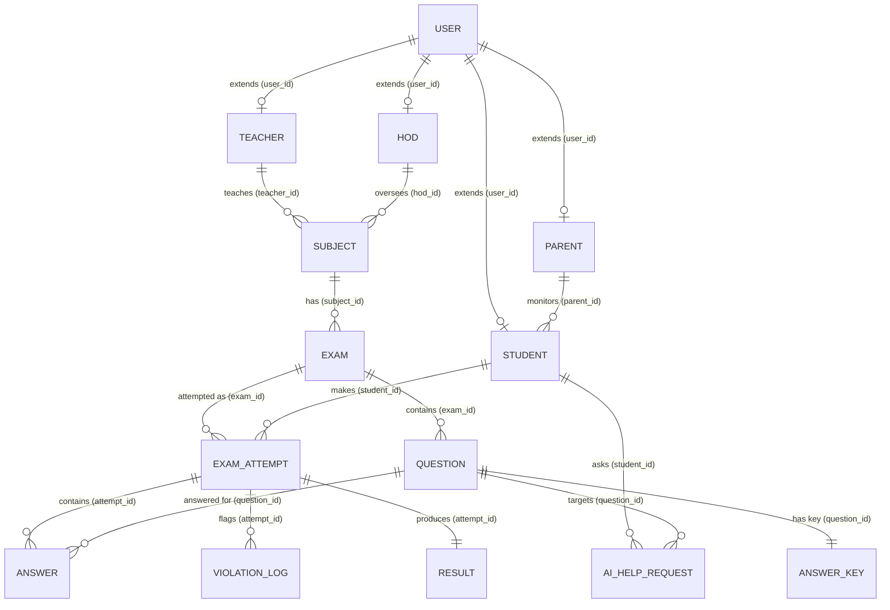
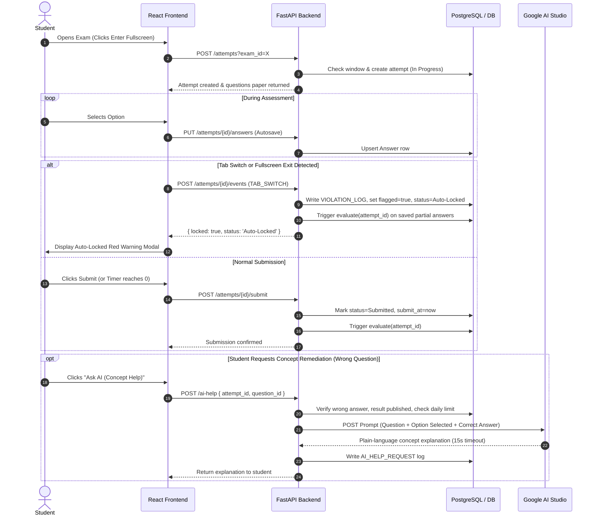

# OEPMS System Architecture & Module Mapping

The **Online Exam Proctoring & Management System (OEPMS)** is architected as a modern, decoupled full-stack platform covering the complete examination lifecycle: user access governance, exam authoring, browser-enforced proctoring, server-side grading, role-specific analytical dashboards, and AI-assisted concept remediation.

---

## 1. System Technology Stack

| Layer | Technology | Key Responsibilities |
| :--- | :--- | :--- |
| **Frontend** | React 18, Vite, React Router v6, Lucide Icons | Responsive UI, Page Visibility API & Fullscreen API proctoring, real-time timer countdown, question navigator, lock overlay |
| **Backend API** | FastAPI (Python 3.11+), Pydantic v2 | High-throughput REST API, custom validation formatting, automated background grading, JWT authentication |
| **ORM & Migrations**| SQLAlchemy 2.0, Alembic | Type-safe entity mappings conforming to Lab-8 ER model, schema migration scripts |
| **Database** | PostgreSQL 16 (production/docker), SQLite in-memory (pytest) | Relational persistence, unique constraints, foreign keys, cascade deletes |
| **AI Integration** | Google AI Studio (Gemini 1.5 Flash) API | Server-side concept remediation for wrong answers with 15s timeout and daily quota controls |
| **Testing** | pytest, pytest-asyncio, Vitest, RTL | 72 unit tests across UT-USR, UT-EXM, UT-ATT; frontend render testing |
| **Containerization**| Docker & Docker Compose | Multi-container deployment (`db`, `backend`, `frontend`) |

---

## 2. Top-Down Module Hierarchy & Folder Mapping (M1 - M7)

| Module ID | Module Name | Architectural Responsibility | Key Source Files |
| :--- | :--- | :--- | :--- |
| **M1** | **User & Access Management** | Authentication, JWT issuance, bcrypt password hashing, 5-strike 15-minute account lockout, user CRUD, role protection, deletion safety rules | `backend/app/models/user.py` `backend/app/schemas/user.py` `backend/app/services/user_service.py` `backend/app/api/auth.py` `backend/app/api/users.py` |
| **M2** | **Exam Management** | Teacher subject verification, exam scheduling, MCQ authoring with options and marks, official answer key submission, paper locking at start time, publish rule validation | `backend/app/models/exam.py` `backend/app/models/question.py` `backend/app/models/answer_key.py` `backend/app/schemas/exam.py` `backend/app/services/exam_service.py` `backend/app/api/exams.py` `frontend/src/pages/ExamBuilder.jsx` |
| **M3** | **Exam Attempt** | Window validation, one attempt per student constraint, server-enforced countdown timer, atomic autosave of answers, manual or timer submission | `backend/app/models/attempt.py` `backend/app/models/answer.py` `backend/app/schemas/attempt.py` `backend/app/services/attempt_service.py` `backend/app/api/attempts.py` `frontend/src/pages/ExamScreen.jsx` |
| **M4** | **Automated Proctoring** | Browser Page Visibility (`visibilitychange`) and Fullscreen API listener, server-side duplicate suppression (1s window), violation logging (`TAB_SWITCH`, `FULLSCREEN_EXIT`), auto-lock transition, trigger partial evaluation | `backend/app/models/violation.py` `backend/app/services/attempt_service.py:on_event` `backend/app/api/attempts.py` `frontend/src/pages/ExamScreen.jsx` |
| **M5** | **Automated Evaluation & Results** | Idempotent comparison with answer key, full marks for correct and 0 for incorrect/blank, total score and percentage calculation, results publication, terminated violation labeling | `backend/app/models/result.py` `backend/app/services/attempt_service.py:evaluate` `backend/app/api/results.py` `frontend/src/pages/ResultReviewPage.jsx` |
| **M6** | **Dashboards & Reporting** | Role-tailored dashboards: Student (marks & upcoming), Teacher (subject averages & violation counts), Parent (linked children only), HOD (30s auto-refresh live monitor and filtered paginated reports), Admin (user management & settings) | `backend/app/services/dashboard_service.py` `backend/app/api/dashboard.py` `frontend/src/pages/*Dashboard.jsx` |
| **M7** | **AI Concept Help** | Server-side Gemini API invocation for wrongly answered questions after results publication, no personal data leakage, 15s timeout, daily quota enforcement, failure retry support | `backend/app/models/ai_help.py` `backend/app/services/ai_service.py` `backend/app/api/ai_help.py` `frontend/src/pages/ResultReviewPage.jsx` |

---

## 3. Database Schema Overview (Lab-8 ER Diagram)

The relational schema implements 15 tables strictly aligned with the Lab-8 specification:

---

## 4. Proctoring & Automated Evaluation Sequence

